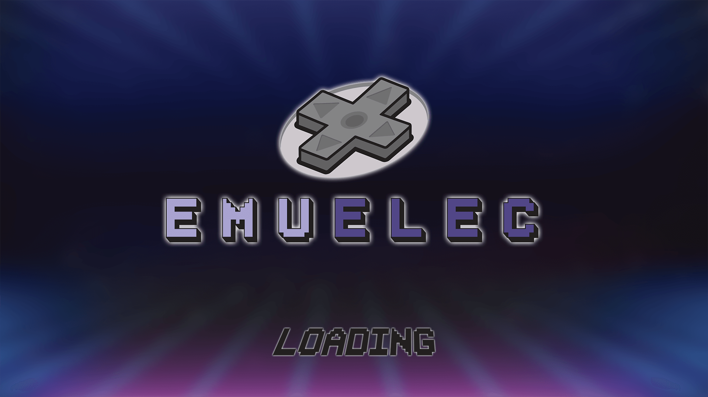

# 🚀 MCD Custom Firmware для портативної консолі M17



[-blue.svg)](https://github.com/MCDShema/MCD_M17)
[](https://github.com/MCDShema/MCD_M17)
[](https://github.com/MCDShema/MCD_M17)
[-brightgreen.svg)](https://github.com/MCDShema/MCD_M17)

Повна готова кастомна прошивка **MCD** для портативної консолі **M17** (Rockchip RK3128, 4x Cortex-A7, Mali-400 GPU). 

Збірка оптимізована як **чиста базова система без ігор** — ви можете записати її на будь-яку картку пам'яті (від 8GB до 256GB+) та самостійно додати лише улюблені ігри.

---

### 📥 Швидке завантаження
👉 **[Завантажити архів прошивки MCD_M17 (ZIP)](https://github.com/MCDShema/MCD_M17/archive/refs/heads/main.zip)**

---

## ✨ Переваги та оптимізації збірки MCD

- ⚡ **Максимальна продуктивність CPU**:
  - Налаштовано профіль роботи процесора `performance governor` на частотах 1.2+ ГГц.
  - Усі 4 ядра процесора зафіксовані в активному стані (`plug_mask = 0xf`).
- 🎮 **400+ емуляторних ядер (Libretro Cores)**:
  - Попередньо скомпільовані та налаштовані ядра для PS1, PSP, N64, GBA, NES, SNES, Sega Mega Drive, Dreamcast, FBNeo, MAME, Commodore, ScummVM тощо.
- 🎨 **Оновлена тема EmulationStation M17**:
  - Чіткі оптимізовані шрифти, швидкий відгук меню без лагів, адаптація під 4.3" дисплей 480x272.
- 🎧 **Виправлення звуку**:
  - Інтегровано виправлення виведення аудіо на роз'єм навушників 3.5 мм (`fix_headphones.sh`).
  - Збережено відкалібрований мікшер `asound.state`.
- 📁 **114 готових папок для консолей у `roms/`**:
  - Каталоги вже названі відповідно до стандартів EmulationStation (`nes`, `sfc`, `gba`, `megadrive`, `psx`, `psp`, `ports` тощо).
- 💾 **Автоматичне налаштування Swap**:
  - Скрипт `em_ui.sh` автоматично генерує та підключає swapfile для запобігання нестачі оперативної пам'яті у важких емуляторах.

---

## 📦 Інструкція зі встановлення на картку пам'яті (microSD)

1. **Підготуйте картку пам'яті**:
   - Відформатуйте вашу microSD карту в:
     - **FAT32** (для карток до 32 ГБ).
     - **exFAT** (для карток 64 ГБ, 128 ГБ, 256 ГБ).
2. **Завантажте прошивку**:
   - Натисніть **Code ➔ Download ZIP** у репозиторії (або [за цим прямим посиланням](https://github.com/MCDShema/MCD_M17/archive/refs/heads/main.zip)).
3. **Скопіюйте файли на картку**:
   - Розархівуйте завантажений ZIP-архів.
   - Скопіюйте всі файли та папки (`.config`, `.emulationstation`, `cores`, `emuelec`, `retroarch`, `roms`, `em_ui.sh` тощо) **прямо в корінь** вашої картки пам'яті.
4. **Додайте свої ігри**:
   - Відкрийте папку `roms` на картці пам'яті та скопіюйте ваші ROM-файли у відповідні папки:
     - `roms/gba/` — для ігор Game Boy Advance (`.gba`)
     - `roms/nes/` — для ігор Dendy / NES (`.nes`)
     - `roms/sfc/` або `roms/snes/` — для Super Nintendo (`.smc`, `.sfc`)
     - `roms/megadrive/` — для Sega Mega Drive (`.bin`, `.md`)
     - `roms/psx/` — для PlayStation 1 (`.chd`, `.iso`, `.cue`/`.bin`)
     - `roms/psp/` — для PlayStation Portable (`.iso`, `.cso`)
     - `roms/ports/` — для портів ігор
5. **Запустіть консоль**:
   - Вставте карту пам'яті в слот M17 та увімкніть консоль.
   - Під час першого запуску система автоматично підготує середовище та відкриє головне меню.

---

## 📁 Структура файлової системи на картці пам'яті

```text
/
├── em_ui.sh                 # Головний скрипт оптимізації заліза та запуску ES
├── emulationstation         # Виконуваний бінарний файл фронтенду
├── fix_headphones.sh        # Скрипт виправлення виходу для навушників
├── asound.state             # Конфігурація аудіомікшера ALSA
├── autorun.ico              # Фірмова іконка накопичувача
├── .config/                 # Системні налаштування EmuELEC та емуляторів
├── .emulationstation/       # Теми інтерфейсу, налаштування та локалізація
├── cores/                   # 400+ ARM-ядер Libretro для RetroArch
├── emuelec/                 # Модулі операційної системи EmuELEC
├── emus/                    # Автономні емулятори (PPSSPP, DraStic тощо)
├── retroarch/               # Базові шейдери, бази даних та оверлеї RetroArch
└── roms/                    # 114 каталогів для розміщення ваших ігор
```

---

### Приємного користування та захопливих ігор на M17! 🕹️✨
